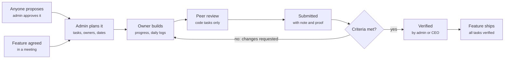

# Cadence — Features Guide

What every part of Cadence does and why it's there, in plain language. Keep this up to date
with each phase (see [CLAUDE.md](../CLAUDE.md) → Phases). The full spec is
[REQUIREMENTS.md](REQUIREMENTS.md).

_As of 9 Nov 2026: Phase 1, Phase 2 and the bento Board are built._

## What Cadence is for

Cadence keeps the four cofounders accountable for everything agreed in meetings: who owns each
piece of work, how far along it is, and whether deadlines are met.

Before Cadence, features agreed in a meeting had no single home, so it was unclear who was
working on what, who was behind and what was really done. Cadence makes three promises:

- **One owner, one deadline.** Every task has exactly one person responsible and one date it's due.
- **Everyone sees everything.** Every feature, task, log and status is visible to the whole team.
- **Done means verified.** Nothing counts as done until someone checks it against its written
  acceptance criteria.

It reports team progress, not rankings: there is no leaderboard. It runs on iPhone and on the
web; the web version is mainly for the COO to plan after meetings.

Built so far: sign-in and roles (Phase 1), and features, tasks, proposals and the Board
(Phase 2). Progress updates, daily logs, reviews and notifications come in Phases 3 to 6 (see
[Coming next](#coming-next)).

## Key ideas

Work has two levels: a **feature** agreed in a meeting, split into **tasks** that each have one
owner and one deadline.

| Term                | What it means                                                                                                                                             | Example                        |
| ------------------- | --------------------------------------------------------------------------------------------------------------------------------------------------------- | ------------------------------ |
| Feature             | A piece of work agreed in a meeting, with a description, the expected result, where it was agreed and a hard deadline.                                    | Onboarding flow, due 21 Nov    |
| Task                | One job a feature is split into. Its deadline must be on or before the feature's.                                                                         | Build the sign-up API          |
| Owner               | The one person responsible for a task. Must be an active member of the team.                                                                              | Kofi                           |
| Deadline            | Picked as a date and counted to the end of that day, Ghana time (GMT).                                                                                    | Due 14 Nov                     |
| Original deadline   | The deadline set when the task was planned, kept so everyone can see if it moved.                                                                         | Originally 10 Nov              |
| Acceptance criteria | The checklist that defines done. The verifier checks each line. Every live task has at least one.                                                         | Works on a small iPhone        |
| Task type           | Code, Design, Content, Operations or Other. Code tasks also name a peer reviewer.                                                                         | Code                           |
| Peer reviewer       | For code tasks: a teammate, never the owner, who reviews the code before it is submitted.                                                                 | The CTO reviews the CEO's code |
| Priority            | Urgent, High, Medium or Low. Urgent and High stand out in colour.                                                                                         | High                           |
| Proposal            | A task anyone can suggest. It goes live only when the admin approves it and sets the owner, deadline and final criteria, or it is declined with a reason. | Dark mode for the web app      |
| Admin and member    | The two roles. Admins plan and approve; members do the work and propose. Titles like CEO or CTO are labels only; permissions come from the role.          | COO = admin                    |

## How work flows

Every feature starts in a meeting and ends in production, and the only gate to done is
verification against the acceptance criteria.

A rejected task loops back to its owner with a reason. Today Cadence covers planning and
proposals; status updates arrive in Phase 3, and peer review and verification in Phase 5.

### Task statuses

| Status            | What it means                                          | Colour on the Board |
| ----------------- | ------------------------------------------------------ | ------------------- |
| Proposed          | Suggested by someone, waiting for the admin            | Rose                |
| Declined          | The admin turned the proposal down; the reason is kept | Red                 |
| To do             | Planned and assigned, not started                      | Cream               |
| In progress       | The owner is working on it                             | Blue                |
| Blocked           | Stuck on something the owner can't fix alone           | Red                 |
| In peer review    | A code task waiting for its peer reviewer              | Violet              |
| Submitted         | The owner says it's done; waiting for verification     | Orange              |
| Changes requested | The verifier sent it back with a reason                | Yellow              |
| Verified          | Checked against every acceptance criterion: done       | Green               |

### Feature stages

| Stage            | What it means                                     | Colour on the Board |
| ---------------- | ------------------------------------------------- | ------------------- |
| Planned          | Agreed and planned; work hasn't started           | Cream               |
| In progress      | Work is under way                                 | Blue                |
| Internal testing | Every task is verified and the team is testing it | Yellow              |
| Shipped          | Live; the admin marked it shipped                 | Green               |

## Getting in

Cadence is invite-only: only an email address the admin has invited can create an account.

- **Welcome screen.** A black screen where a field of dots swirls, gathers into the word
  "cadence" and dissolves again. Two buttons: **Sign in** and **I have an invite**. With Reduce
  Motion on, the word simply shows.
- **Sign in.** Email and password. Wrong details show "That email and password don't match an
  account."
- **Join Cadence** (I have an invite). Your name, the email your invite was sent to, and a
  password of at least 8 characters. You get the role and title from your invite. Any other
  email is turned away with "This email hasn't been invited to Cadence."
- **Passwords.** There is no default password. Everyone picks their own, and it is stored
  scrambled, so nobody, admins and developers included, can read it. A forgotten-password reset
  is not built yet.
- **Deactivated accounts.** When an admin deactivates someone, they are signed out on every
  device, can't sign back in, and the app explains why.
- **Staying signed in.** On iPhone your session is kept in the Keychain; on the web, in the
  browser.

## The Board

The Board is the home screen: a dashboard of coloured tiles that sums up the whole team, then
the full list of features and their tasks. It is always black, whatever the phone's light or
dark setting, and the tab bar turns black too while the Board is showing.

### The tiles

The tiles always count the whole team, even when the list below is filtered.

| Tile                               | What it shows                                                                                           | Tap it to                                                                           |
| ---------------------------------- | ------------------------------------------------------------------------------------------------------- | ----------------------------------------------------------------------------------- |
| due this week (violet)             | How many unverified tasks are due in the next 7 days                                                    | Open a page of those tasks, grouped by feature                                      |
| overdue (orange)                   | How many unverified tasks are past their deadline                                                       | Open a page of those tasks, grouped by feature                                      |
| waiting (yellow)                   | How many proposals are waiting for approval                                                             | Open a page of every waiting proposal; the admin approves or declines from each one |
| next up (tall, cream)              | The nearest deadline: the task, its owner and feature, the date, and "in 3 days" or "2 days late"       | Open that task                                                                      |
| the team · Progress (dark)         | Total tasks, how many are verified, in progress and blocked, and bars for To do, Doing, Review and Done | Nothing; it's a summary                                                             |
| assigned to me (green)             | How many of your own tasks are still open                                                               | Open My Tasks                                                                       |
| New feature or Propose task (blue) | Admins plan a feature; members suggest a task                                                           | Open the form                                                                       |
| every task / one owner (red)       | Cadence's promise, in big letters                                                                       | Nothing                                                                             |
| how does it work? (yellow)         | A two-line guide to the Board                                                                           | Its × hides it for good on this device                                              |

### The pit stop

When the Board first loads, the tiles fly in from the sides and slam into place. Pull the Board
down past the top and let go to replay it. It plays again after the app is fully closed and
reopened, not when switching apps or tabs. With Reduce Motion on, it never plays.

### The features section

Below the tiles is every feature as a dark card, with its tasks listed underneath.

- **The card header** shows the feature's name, its stage (Planned, In progress, Internal
  testing or Shipped), its deadline and how many tasks it has. Tap it to open the feature page.
- **Each task row** shows the title, a coloured status pill, the owner, the due date (in red
  when overdue), the priority and the type. Tap it to open the task.
- **Filters.** The Owner, Feature and Status chips narrow the list; **Clear** resets them.

### The tile pages

**Due this week**, **overdue** and **waiting** each open their own page in the Board's black
style: a big title, how many tasks it holds, and the matching tasks grouped under their
features, in the same rows as the Board. Tap a feature or task to open it; the back arrow
returns to the Board. On the waiting page each row says who proposed it.

## Features, tasks and proposals

The admin turns each meeting decision into a feature and its tasks; anyone can suggest a task as
a proposal.

### The feature page

Shows the feature's stage, deadline, description, expected result, where it was agreed and who
planned it, then its tasks and any proposals waiting for approval. Admins get **Add task** and
**Edit feature**; members get **Propose a task**. A shipped feature takes no new work.

### The task page

Shows the status, priority and type, the title, a link back to its feature, the owner, the peer
reviewer (code tasks), the deadline (with "Originally …" if it moved), who proposed it, the
description and the numbered acceptance criteria. Admins get **Edit task**. A declined proposal
shows the reason in a red box.

### Planning a feature (admin)

Title, description, expected result, where it was agreed (optional) and the deadline, which
can't be in the past. A new feature starts as **Planned**.

### Planning a task (admin)

The feature, title, description, type, priority, acceptance criteria (add or remove lines),
owner, peer reviewer for code tasks, and a deadline between today and the feature's deadline. A
new task starts as **To do**.

- Editing uses the same form. An overdue task can still be edited if its deadline is left as it is.
- A feature's deadline can't move earlier than one of its tasks' deadlines; move the task first.
- On iPhone the date is picked with the system date picker; on the web, with the browser's date
  picker.

### Proposals

1. **Anyone proposes** a task under a feature: title, description, type, priority and suggested
   acceptance criteria. It appears in the proposer's My Tasks and in the admin's queue, but not
   on the Board.
2. **The admin reviews it** from the task page with **Review & approve** or **Decline**.
3. **Approve:** the admin sets the owner, deadline and final criteria, and it becomes a live To
   do task on the Board.
4. **Decline:** the admin must give a reason. The proposal is kept, marked Declined, and the
   proposer sees why.

## The other tabs

Besides the Board there are four tabs; the Admin tab appears only for admins.

| Tab                 | What it's for             | What's on it                                                                                                                                                         |
| ------------------- | ------------------------- | -------------------------------------------------------------------------------------------------------------------------------------------------------------------- |
| My Tasks            | Your own work at a glance | **Assigned to me**: your tasks, soonest deadline first. **My proposals**: what you've suggested, including declined ones with the reason. A **Propose task** button. |
| Logs                | Daily work logs           | A placeholder for now; the log form arrives in Phase 4.                                                                                                              |
| Profile             | Your account              | Your name, title, role badge, email and time zone, and **Sign out**.                                                                                                 |
| Admin (admins only) | Running the team          | **Proposals to review**, a **New feature** button and the list of invites, each marked Pending or Joined.                                                            |

## Who can do what

Everyone sees everything; only admins plan and decide. Every rule is checked on the server, so
hiding a button is never the only protection.

| Action                                                          | Admin                 | Member |
| --------------------------------------------------------------- | --------------------- | ------ |
| See the Board, every feature, task and proposal                 | Yes                   | Yes    |
| Propose a task                                                  | Yes                   | Yes    |
| Create and edit features                                        | Yes                   | No     |
| Create and edit tasks, including owners, deadlines and criteria | Yes                   | No     |
| Approve or decline proposals                                    | Yes                   | No     |
| Invite people, change roles, deactivate accounts                | Yes (screens to come) | No     |
| Change team settings                                            | Yes                   | No     |

- More than one admin is allowed; the last active admin can't be demoted or deactivated.
- Deactivated people can't be given work.
- From Phase 3, members also update status and progress on their own tasks, request deadline
  extensions and peer-review code.

## Behind the scenes

A few things work without a screen of their own.

- **Invites.** The four cofounders were invited when Cadence was set up. Each invite carries a
  role and a title, and works once.
- **Team settings.** Team rules are stored as settings, not written into the app, so they can
  change without a new release: the admin task reviewer (the CEO, who verifies tasks the admin
  owns), the morning digest time (08:00), the daily log reminder (20:00), the team time zone
  (Africa/Accra, GMT) and the late-extension window (24 hours).
- **Activity log.** Every change is recorded with who made it, when, and what it was before and
  after: sign-ups, invites, features, tasks, proposals and settings. Deadlines, reviews,
  verifications and logs are never deleted.
- **Live updates.** A change made on one device appears on everyone else's within seconds;
  nobody needs to refresh.
- **Offline banner.** Cadence works online only. When the connection drops, an amber bar says
  "You're offline. Changes won't save until you reconnect."
- **Demo data (development only).** The development copy can be filled with sample features and
  tasks (titles start with "Demo:", sample people are marked "(demo)") to try the Board, and
  emptied again with one command (`bunx convex run demo:seed` / `demo:clear`). Never used on the
  live app.

## Coming next

Four more phases complete version 1; each starts once the previous one runs on a phone.

| Phase                           | What it adds                                                                                                                                                                                                                                                                                                                                                                                         |
| ------------------------------- | ---------------------------------------------------------------------------------------------------------------------------------------------------------------------------------------------------------------------------------------------------------------------------------------------------------------------------------------------------------------------------------------------------- |
| 3. Progress and extensions      | Owners move their tasks through the statuses, set a progress percentage and comment. Overdue tasks are flagged automatically. Owners can ask for a later deadline with a reason and a type (scope change or other); the admin approves or declines. An approved extension counts as late if it was asked for within 24 hours of the deadline or isn't a scope change. A screen for the activity log. |
| 4. Daily logs                   | A short log every weekday: what I did, what's next, blockers and linked tasks. An optional one-liner at weekends, never counted as missed. Each person's history, with missed weekdays recorded.                                                                                                                                                                                                     |
| 5. Peer review and verification | Code tasks go to their peer reviewer first. Owners submit with a note and proof (a link, screenshot, PR or build). The admin checks each acceptance criterion and verifies or sends it back with a reason; the CEO does this for tasks the admin owns. A feature moves to Internal testing once all its tasks are verified, and to Shipped when the admin marks it live.                             |
| 6. Notifications and release    | One 8am digest: your tasks due in 48 hours, your overdue tasks, reviews waiting on you, and yesterday's missing log. Instant pushes only for assignments, review requests, verifications and decisions. An 8pm reminder on weekdays if your log isn't in. Then a TestFlight build and the web version going live.                                                                                    |

After version 1: a team health dashboard (features on track, overdue counts, log consistency),
GitHub links for code tasks, a contribution graph and an Android build.
