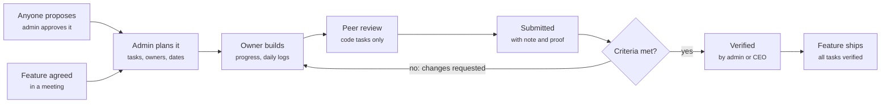

# Cadence — Features Guide

What every part of Cadence does and why it's there, in plain language. Keep this up to date
with each phase (see [CLAUDE.md](../CLAUDE.md) → Phases). The full spec is
[REQUIREMENTS.md](REQUIREMENTS.md).

_As of 10 Nov 2026: Phase 1, Phase 2, the bento Board, the feature, person and task pages, the black and off-white themes, and the Settings tab with its People and Team rules pages, and Phase 4 (progress, comments, requests for more time and the Activity page) are built._

## What Cadence is for

Cadence keeps the four cofounders accountable for everything agreed in meetings: who owns each
piece of work, how far along it is, and whether deadlines are met.

Before Cadence, features agreed in a meeting had no single home, so it was unclear who was
working on what, who was behind and what was really done. Cadence makes three promises:

- **One owner, one deadline.** Every task has exactly one person responsible and one date it's due.
- **Everyone sees everything.** Every feature, task, log and status is visible to the whole team.
- **Done means verified.** Nothing counts as done until someone checks it against its written
  acceptance criteria.

It reports team progress, not rankings: there is no leaderboard. It runs on iPhone and on the
web; the web version is mainly for the COO to plan after meetings. It has two looks, black and a
warm off-white. It follows the phone's dark or light setting until someone flips **Dark mode** in
Settings; from then on that choice sticks on that phone; the coloured tiles, status pills
and cards keep their colours in both.

On a computer (a browser window at least 1,000 pixels wide) the web version is laid out like a
website rather than a phone: a sidebar instead of the tab bar, forms that open as dialogs over the
page, and its own Board ([The Board on a computer](#the-board-on-a-computer)). In a narrower
window, or in a phone's browser, it looks like the app.

Built so far: sign-in and roles (Phase 1), and features, tasks, proposals and the Board
(Phase 2). Progress updates, daily logs, reviews and notifications come in Phases 4 to 7 (see
[Coming next](#coming-next)).

## Key ideas

Work has two levels: a **feature** agreed in a meeting, split into **tasks** that each have one
owner and one deadline.

| Term                | What it means                                                                                                                                             | Example                        |
| ------------------- | --------------------------------------------------------------------------------------------------------------------------------------------------------- | ------------------------------ |
| Feature             | A piece of work agreed in a meeting, with a description, the expected result, where it was agreed and a hard deadline.                                    | Onboarding flow, due 21 Nov    |
| Task                | One job a feature is split into. Its deadline must be on or before the feature's.                                                                         | Build the sign-up API          |
| Owner               | The one person responsible for a task. Must be an active member of the team.                                                                              | Kofi                           |
| Deadline            | Picked as a date and counted to the end of that day, Ghana time (GMT).                                                                                    | Due 14 Nov                     |
| Original deadline   | The deadline set when the task was planned, kept so everyone can see if it moved.                                                                         | Originally 10 Nov              |
| Acceptance criteria | The checklist that defines done. The verifier checks each line. Every live task has at least one.                                                         | Works on a small iPhone        |
| Task type           | Code, Design, Content, Operations or Other. Code tasks also name a peer reviewer.                                                                         | Code                           |
| Peer reviewer       | For code tasks: a teammate, never the owner, who reviews the code before it is submitted.                                                                 | The CTO reviews the CEO's code |
| Priority            | Urgent, High, Medium or Low. Urgent and High stand out in colour.                                                                                         | High                           |
| Proposal            | A task anyone can suggest. It goes live only when the admin approves it and sets the owner, deadline and final criteria, or it is declined with a reason. | Dark mode for the web app      |
| Admin and member    | The two roles. Admins plan and approve; members do the work and propose. Titles like CEO or CTO are labels only; permissions come from the role.          | COO = admin                    |

## How work flows

Every feature starts in a meeting and ends in production, and the only gate to done is
verification against the acceptance criteria.

A rejected task loops back to its owner with a reason. Today Cadence covers planning and
proposals; status updates arrive in Phase 4, and peer review and verification in Phase 6.

### Step by step

The whole system, from joining the team to shipping a feature. Steps 1 to 4 are built; the
rest arrive in the phase shown.

1. **Join (built).** The admin invites an email with a role and a title (e.g. CTO). The person
   signs up with that email; nobody else can. Admins plan and decide; members do the work.
   Deactivated accounts can't get in.
2. **Plan the feature (built).** After a meeting, the admin creates the feature, on the web or
   phone: what it is, the expected result, which meeting agreed it and a hard deadline. It
   starts as **Planned**.
3. **Plan its tasks (built).** The admin splits the feature into tasks. Each gets one owner, a
   deadline no later than the feature's, a priority, a type and at least one acceptance
   criterion. Code tasks also get a peer reviewer, who can't be the owner. A new task starts as
   **To do**.
   - _Side door, proposals:_ anyone can suggest a task under a feature. The admin approves it
     (sets the owner, deadline and final criteria, and it becomes To do) or declines it with a
     reason (kept as Declined).
4. **Everyone sees everything (built).** The Board, its tile pages, feature pages, task pages,
   My Tasks and the Admin tab all show the same live data; a change appears on every device
   within seconds.
5. **Do the work (Phase 4).** The owner moves their task to **In progress** or **Blocked**, sets
   a progress % and comments. Once a deadline passes without verification, the task is flagged
   **overdue** automatically. The owner can ask for a new deadline with a reason and a type; the
   admin decides. An extension counts as late if it was asked for within 24 hours of the
   deadline or isn't a meeting-agreed scope change. Every change goes into the activity log.
6. **Daily logs (Phase 5).** Each weekday, everyone writes a short log: what I did, what's next,
   blockers, and which tasks it touched. Missed weekdays are recorded. Weekends get an optional
   one-liner that is never counted as missed.
7. **Peer review (Phase 6, code tasks only).** The owner asks for review (**In peer review**);
   the reviewer approves it or sends it back with comments. The CTO reviews the CEO's code and
   the CEO reviews the CTO's.
8. **Submit (Phase 6).** The owner submits with a note and optional proof (a link, screenshot or
   PR). The task becomes **Submitted**; the owner's part is done.
9. **Verify (Phase 6).** The admin checks each acceptance criterion. The task becomes
   **Verified**, or goes to **Changes requested** with a reason and back to step 5. The CEO
   verifies the admin's own tasks, so nobody approves their own work. Only Verified counts as
   done.
10. **Ship the feature (Phase 6).** When every task in a feature is verified, the feature moves to
    **Internal testing**; the admin marks it **Shipped** once it's live. A shipped feature takes
    no new work.
11. **Notifications and release (Phase 7).** Instant pushes only for: a task assigned to you, a
    review or verification request, a verified or changes-requested decision, and an extension or
    proposal decision. An 8am GMT digest lists your tasks due within 48 hours, your overdue ones,
    reviews waiting on you and whether yesterday's log is missing; an 8pm reminder comes if
    today's log isn't in. Then a TestFlight build and a web deploy.

### Whose move it is

Each status says who has to act next.

| Status                                         | Whose move                                                 |
| ---------------------------------------------- | ---------------------------------------------------------- |
| Proposed                                       | The admin (approve or decline)                             |
| To do, In progress, Blocked, Changes requested | The owner                                                  |
| In peer review                                 | The peer reviewer                                          |
| Submitted                                      | The verifier (the admin, or the CEO for the admin's tasks) |
| Verified, Declined                             | Nobody; it's finished                                      |

### Task statuses

| Status            | What it means                                          | Colour on the Board |
| ----------------- | ------------------------------------------------------ | ------------------- |
| Proposed          | Suggested by someone, waiting for the admin            | Rose                |
| Declined          | The admin turned the proposal down; the reason is kept | Red                 |
| To do             | Planned and assigned, not started                      | Cream               |
| In progress       | The owner is working on it                             | Blue                |
| Blocked           | Stuck on something the owner can't fix alone           | Red                 |
| In peer review    | A code task waiting for its peer reviewer              | Violet              |
| Submitted         | The owner says it's done; waiting for verification     | Orange              |
| Changes requested | The verifier sent it back with a reason                | Yellow              |
| Verified          | Checked against every acceptance criterion: done       | Green               |

### Feature stages

| Stage            | What it means                                     | Colour on the Board |
| ---------------- | ------------------------------------------------- | ------------------- |
| Planned          | Agreed and planned; work hasn't started           | Cream               |
| In progress      | Work is under way                                 | Blue                |
| Internal testing | Every task is verified and the team is testing it | Yellow              |
| Shipped          | Live; the admin marked it shipped                 | Green               |

## Getting in

Cadence is invite-only: only an email address the admin has invited can create an account.

- **Welcome screen.** A field of dots swirls, gathers into the word
  "cadence" and dissolves again. Two buttons: **Sign in** and **I have an invite**. With Reduce
  Motion on, the word simply shows.
- **Sign in.** Email and password. Wrong details show "That email and password don't match an
  account."
- **Join Cadence** (I have an invite). Your name, the email your invite was sent to, the
  **invite code** that came with it (e.g. K7PQ-3MX9; capitals, spaces and the dash don't
  matter) and a password of at least 8 characters. You get the role and title from your invite.
  Codes work once and expire after 14 days. Anything that doesn't match (an email with no
  invite, a wrong or expired code, an email that already has an account) gets the same reply:
  "We couldn't create your account. Check your email and invite code, or ask an admin for a new
  code." That way nobody can find out who has been invited by trying addresses.
- **Passwords.** There is no default password. Everyone picks their own, and it is stored
  scrambled, so nobody, admins and developers included, can read it. A forgotten-password reset
  is not built yet.
- **Deactivated accounts.** When an admin deactivates someone, they are signed out on every
  device, can't sign back in, and the app explains why.
- **Staying signed in.** On iPhone your session is kept in the Keychain; on the web, in the
  browser.

## The Board

The Board is the home screen: a dashboard of coloured tiles that sums up the whole team, then
the full list of features and their tasks. Like every screen, it is black or off-white,
following the phone's dark or light setting; the tiles keep their colours in both.

### The tiles

The tiles always count the whole team, even when the list below is filtered.

| Tile                               | What it shows                                                                                                                            | Tap it to                                                                                              |
| ---------------------------------- | ---------------------------------------------------------------------------------------------------------------------------------------- | ------------------------------------------------------------------------------------------------------ |
| due this week (violet)             | How many unverified tasks are due in the next 7 days                                                                                     | Open a page of those tasks, grouped by feature                                                         |
| overdue (orange)                   | How many unverified tasks are past their deadline                                                                                        | Open a page of those tasks, grouped by feature                                                         |
| waiting (yellow)                   | What's waiting for a decision: "2 proposals", "1 request" (for more time), or "3 pending" when it's both                                 | Open a page of every request for more time and every proposal; each opens its task, where it's decided |
| next up (tall, cream)              | The feature due next (not yet shipped): its name, "2 of 5 tasks verified", a progress bar, its deadline and "in 3 days" or "2 days late" | Open that feature's page                                                                               |
| the team · Progress (dark)         | Total tasks, how many are verified, in progress and blocked, and bars for To do, Doing, Review and Done                                  | Nothing; it's a summary                                                                                |
| assigned to me (green)             | How many of your own tasks are still open                                                                                                | Open My Tasks                                                                                          |
| New feature or Propose task (blue) | Admins plan a feature; members suggest a task                                                                                            | Open the form                                                                                          |
| every task / one owner (red)       | Cadence's promise, in big letters                                                                                                        | Open **Activity**: every change, who made it and when (below)                                          |
| how does it work? (yellow)         | A two-line guide to the Board                                                                                                            | Its × hides it for good on this device                                                                 |

### Activity

The red "every task, one owner" tile opens the team's activity: every change, who made it and
when, newest first, grouped by day (Today, Yesterday, Tue 10 Nov…). Each entry is a sentence with
the person's avatar ("Kofi asked for more time on Payments API spike: until Fri 27 Nov (scope
change)"), with what they wrote under it: comments as bubbles, notes and reasons as quotes.
Cadence's own entries (a task flagged overdue) have a yellow clock instead of an avatar. The chips
at the top show one person's activity only; tap an entry about a task or a feature to open it.
It loads 30 at a time (**Show older**). Everyone sees it, but entries about invites only reach
admins.

### The pit stop

When the Board first loads, the tiles fly in from the sides and slam into place. Pull the Board
down past the top and let go to replay it. It plays again after the app is fully closed and
reopened, not when switching apps or tabs. With Reduce Motion on, it never plays.

### The features section

Below the tiles is every feature that hasn't shipped, as a card with its tasks listed underneath.
A shipped feature leaves the Board; pick it in the Feature filter to see it again.

- **The card header** shows the feature's name, its stage (Planned, In progress, Internal
  testing or Shipped), its deadline and how many tasks it has. Tap it to open the feature page.
- **Each task row** shows the title, a coloured status pill, the owner, the due date (in red
  when overdue), the priority and the type. Tap it to open the task.
- **Filters.** The Owner, Feature and Status chips narrow the list; **Clear** resets them.

### The tile pages

**Due this week**, **overdue** and **waiting** each open their own page in the Board's
style: a big title, how many tasks it holds, and the matching tasks grouped under their
features, in the same rows as the Board. Tap a feature or task to open it; the back arrow
returns to the Board. On the waiting page each row says who proposed it.

### The Board on a computer

On a computer the Board is a dashboard page, after a learning-dashboard design the team picked on
Pinterest, instead of the phone's tiles. Everything on the phone's Board is still there.

- **The sidebar** (on every page) lists Board, My Tasks, Logs, Activity and Admin (admins), then
  the features in progress (each with its stage's colour; admins also get **New feature**), then
  Settings and you. Its arrow collapses it to icons and back: it glides, the icons stay where they
  are, and the choice is remembered on that browser. With Reduce Motion on, it switches at once.
  (Browsers turn Reduce Motion on when Windows' "Animation effects" or the Mac's "Reduce motion"
  setting is on.) Collapsing or opening it only stretches the page; nothing rearranges.
- **The top** shows the date and a welcome, a search box (tasks, features and people; press **/**
  to jump to it, **Esc** to clear it), a bell that opens Activity, and you (your account).
- **The title row** has **New feature** for admins or **Propose a task** for members. Under it, a
  chip per person (**Everyone**, **You**, then each teammate) and a **Status** filter; **Clear**
  resets them. The filters and the search work together.
- **Features** shows every feature that hasn't shipped as a coloured card: its stage, when it's
  due (in red when it's late), its name, how far along it is with "1/4 verified" and a bar, who's
  working on it, and **Open**. The whole card opens the feature page. Three cards to a row in a
  wide window, two in a narrower one. With a filter on, only features with matching tasks show.
- **Coming up** is a table of the open tasks, soonest deadline first (so late ones lead): the
  task and its feature, the owner, the status, and when it's due ("tomorrow", "2 days late" in
  red). It shows six, then **View all**. Click a row to open the task. Verified tasks only show
  when the Status filter is set to Verified.
- **Next up** is the dark card: the feature due next (or the most overdue), its due date, how far
  along it is, who's on it and **Open feature**. **At a glance** lists Overdue, Due this week,
  Waiting for a decision and Your open tasks, each opening its page. These two always count the
  whole team, whatever the filters. In a very wide window (1,400 pixels or more) they sit beside
  the table; otherwise they sit side by side above it.

## Features, tasks and proposals

The admin turns each meeting decision into a feature and its tasks; anyone can suggest a task as
a proposal.

### The feature page

The Board's **next up** tile, every feature card, and the grey line under a task's or person's
name open it.
From top to bottom:

- **Header.** A round back button on its own, then the feature's title in big letters, with where
  it was agreed and who planned it underneath.
- **The status card.** The same shiny tilting card as the task page, spelling the feature's stage
  (PLANNED, IN PROGRESS, TESTING, SHIPPED). A feature has no owner, so the bottom line shows how
  many tasks it has and how many are verified. A shipped feature's card shines brighter.
- **The countdown card.** "Feature due in …" to the feature's own deadline, red and counting up
  once it's late, with the LATE or TODAY sticker. Its progress bar is the average of the tasks'
  progress (a verified task counts as 100%), with "2 of 5 tasks verified" beside it, since only
  verified counts as done. A shipped feature shows "Done".
- **Description** and **Expected result** on dark cards.
- **Who's on it.** A pastel card for everyone working on the feature: each task owner (orange,
  with how many tasks they own and their progress) and each peer reviewer on its code tasks
  (blue). Tap a card to see that person's work on the feature (below).
- **Tasks.** Every task, in the Board's rows, each with its progress bar. Tap one to open it.
- **Waiting for approval.** Proposals for this feature, if any.
- **Buttons.** Admins get **Add task** and **Edit feature**; members get **Propose a task**. A
  shipped feature takes no new work, so only **Edit feature** remains.

### A person's work on a feature

Tap someone in **Who's on it** (on the feature page, or the owner or reviewer card on a task page)
to see what they're doing for that feature:

- Their name, title and role on it (owner, peer reviewer, or both).
- A summary card: how many tasks they own there, how many are verified and their overall progress.
- **Their tasks**, each in full: status, deadline (red when overdue), priority, type, progress,
  and the acceptance criteria they have to deliver, ticked once the task is verified. Tap one to
  open it.
- **Reviewing**: the code tasks there they peer-review.
- What they log each day (Phase 5) and the proof they submit (Phase 6) will be added to this page
  when those phases are built.

### The task page

From top to bottom:

- **Header.** A round back button on its own, then the task's title in big letters with "Part of
  <feature> ›" under it (or "Proposed for <feature> ›"). Tap that line to open the feature.
- **The status card.** A black card whose huge shiny word is the task's status (TO DO, IN
  PROGRESS, IN REVIEW, VERIFIED…), with the owner's name (or the proposer's) and the task type
  along the bottom. On iPhone it tilts in 3D: press and hold it for a moment, then drag, and the
  rainbow shine follows your finger; let go and it wobbles back. It also wobbles once when the
  page opens, so people find out it moves. A verified task's card shines brighter. On the web the
  card holds still.
- **Counts as late (yellow).** Once an approved extension counted as late, a yellow note says
  so. It stays on the record.
- **More time asked for (peach).** While the owner's request for a later deadline waits: the date
  asked for, the type (scope change or other), when and why, and what approving would do ("counts
  the task as late", "moves the feature too" when the date is past the feature's). Whoever
  decides gets **Approve** (with an optional note) and **Decline** (with a reason the owner
  reads) right there; everyone else sees who it's waiting for, and whoever asked can **Withdraw
  request**. It can only be declined once the task has gone to its reviewer, its feature has
  shipped, or it has moved to a new owner (a new owner's task closes any request the old owner
  made).
- **The countdown card (lavender).** "Task due in 2d 14h 33m 07s", ticking every second with
  digits that roll like a car's odometer. Under it, the task's own deadline ("originally …" if it
  moved) and the feature's deadline, so it's clear which is which. The priority sits on a pink
  tag, and the progress bar at the bottom. Once the deadline passes, the card turns red and the
  clock counts up ("Task late by …"). A yellow sticker says **LATE**, **TODAY** (due today) or
  **URGENT**. A verified task shows "Done" and the day it was verified. A proposal shows "No
  deadline yet".
- **The owner's buttons** (only the owner, while the task is in their hands: to do, in progress,
  blocked, or sent back with changes requested). **Post an update** opens a card: the status (To
  do, In progress, Blocked), the progress on a thick bar you drag (it snaps to 5%, the number
  rolls, and the iPhone gives a light tap at each step) and a note. Marking it Blocked needs a
  note saying what's in the way. **Ask for more time** opens a card: the new date, why it moves
  (scope change, agreed in a meeting, or other) and why you need it. It says straight away whether
  approving would count the task as late, and whether the date is past the feature's deadline.
  One request at a time. On an admin's own task, the admin task reviewer decides; if none is
  set (or the reviewer owns the task), the button is replaced by a note saying so.
- **Description** on a dark card, if there is one.
- **Who's on it.** Pastel cards: the owner (orange, with the priority), the peer reviewer for code
  tasks (blue) and whoever proposed it (pink), each with initials, name and title. Someone who
  has left is tagged "Deactivated". Tap the owner or reviewer to see their work on the feature.
- **Acceptance criteria** on a dark card, numbered; they turn into ticks once the task is verified.
- **Buttons (admins only).** **Edit task**, except while the task is in review, submitted or
  verified, when a note says its plan is locked.
- **Updates and comments.** Everything that happened to the task, newest first: created, each
  update ("marked it blocked at 85%" with the note), requests for more time and the decisions,
  "Cadence flagged it overdue" when the deadline passed, and comments as speech bubbles. Anyone
  can comment from the box at the top (not on a declined proposal). Comments can't be edited or
  deleted: they're part of the record.

On a proposal, a lavender note says it's waiting for an admin (for the admin: waiting for your
review), and the admin gets **Review & approve** and **Decline**. **Decline** opens a box for the
reason. A declined proposal shows the reason in a red note.

With Reduce Motion on, the card doesn't wobble, the digits change without rolling and the
sticker doesn't pop.

### Planning a feature (admin)

Title, description, expected result, where it was agreed (optional) and the deadline, which
can't be in the past. A new feature starts as **Planned**.

### Planning a task (admin)

The feature, title, description, type, priority, acceptance criteria (add or remove lines),
owner, peer reviewer for code tasks, and a deadline between today and the feature's deadline. A
new task starts as **To do**.

- Editing uses the same form. An overdue task can still be edited if its deadline is left as it is.
- **Moving a deadline.** While a task hasn't started (To do, no progress, not overdue), an admin
  moves its deadline freely: that's still planning. Once it has started, moving it later asks
  **Why the deadline moves** (scope change or other) and the same late rule as a request for more
  time applies: "other", or a move less than 24 hours before the deadline (or after it), counts
  the task as late, and says so before saving. Moving it earlier asks nothing.
- **An admin's own task.** No admin moves the deadline of a task an admin owns, their own or
  another admin's: the date is greyed out with the reason, and it moves only through the owner's
  request for more time, decided by the admin task reviewer.
- **Locked in review.** Once a task is In peer review, Submitted or Verified, its plan can't be
  edited, so a review is never judged against something that changed. It unlocks when the task
  is sent back to its owner.
- A feature's deadline can't move earlier than one of its tasks' deadlines; move the task first.
- On iPhone, tapping the date opens the calendar in a sheet; nothing changes until **Done**. On
  the web, the browser's date picker.
- Every form has **Cancel** at the top. Closing a form with changes (Cancel, back, or swiping it
  down) asks "Discard changes?" first. A problem with what was entered shows just above the save
  button.
- After **Add task** (or **Propose a task**) the form closes back to where it was opened, usually
  the feature page, ready for the next task.

### Proposals

1. **Anyone proposes** a task under a feature: title, description, type, priority and suggested
   acceptance criteria. It appears in the proposer's My Tasks and in the admin's queue, but not
   on the Board.
2. **The admin reviews it** from the task page with **Review & approve** or **Decline**.
3. **Approve:** the admin sets the owner, deadline and final criteria, and it becomes a live To
   do task on the Board.
4. **Decline:** the admin must give a reason. The proposal is kept, marked Declined, and the
   proposer sees why.

## The other tabs

Besides the Board there are four tabs; the Admin tab appears only for admins.

| Tab                 | What it's for             | What's on it                                                                                                                                                                                                                                                                                                                                                                                                                                                                                                                                                                                                                                                                                                                                     |
| ------------------- | ------------------------- | ------------------------------------------------------------------------------------------------------------------------------------------------------------------------------------------------------------------------------------------------------------------------------------------------------------------------------------------------------------------------------------------------------------------------------------------------------------------------------------------------------------------------------------------------------------------------------------------------------------------------------------------------------------------------------------------------------------------------------------------------ |
| My Tasks            | Your own work at a glance | **Waiting on you**: requests for more time that are yours to decide (admins, and the admin task reviewer for an admin's own task). **Assigned to me**: your tasks, soonest deadline first. **My proposals**: what you've suggested, including declined ones with the reason. A **Propose task** button.                                                                                                                                                                                                                                                                                                                                                                                                                                          |
| Logs                | Daily work logs           | A placeholder for now; the log form arrives in Phase 5.                                                                                                                                                                                                                                                                                                                                                                                                                                                                                                                                                                                                                                                                                          |
| Settings            | You and the team          | The **Dark mode** switch on a clay scene of a house on a hill: turning it on plays a sunset (the sun goes down, lights come on, the icons light up one by one) and switches the whole app to black; off brings the day and the off-white back. You can also drag across the sky to move the sun. Your choice is kept on this phone. Then five rows: Notifications (the morning digest time), Daily log reminder (its time), People (how many), Team rules (who verifies the admin's tasks) and **Account & security**, which opens your name, title, role, email and time zone, and **Sign out**. An admin taps Notifications or Daily log reminder to change that time on a time wheel. **People** and **Team rules** open their pages (below). |
| Admin (admins only) | Running the team          | **More time to decide** (requests for more time that are yours to decide), **Proposals to review** and a **New feature** button. Invites live on the People page (Settings → People).                                                                                                                                                                                                                                                                                                                                                                                                                                                                                                                                                            |

## People

Settings → People is the team, after a "pick an expert" design: a dark panel of round avatars.

- **The team.** Everyone on Cadence as a round avatar (their initials on a pastel), four to a
  row, with their first name and title. Admins carry a small violet **Admin** tag; your own
  says **You**. Above it, how many people and admins there are. Admins have a round **+** button
  at the top to invite someone.
- **A person's card.** Tap anyone (members too) and their card rises from the bottom, styled like
  a magazine page: their pastel with big initials and stickers (a seal with their role, an
  envelope, a heart on your own card, a green stamp if they're the admin task reviewer), then
  "Kofi is a MEMBER" with the role underlined in pen and their title circled, when they joined,
  their email and time zone. Admins see their options beneath: **Make admin** / **Make member**,
  **Deactivate** / **Reactivate**. Each asks first, inside the card, and says what will happen
  (e.g. a deactivated person is signed out everywhere; if they're the admin task reviewer, choose
  someone else in Team rules). The page never offers what the server would refuse: nobody can
  deactivate themselves, and the last active admin stays an admin.
- **Waiting to join** (admins only). Each pending invite as a row: the email, its code (or "No
  code yet" / "Code expired", with a yellow dot) and until when the code works. Tap one for
  **Share code** (the phone's share sheet: Messages, mail, WhatsApp; on the web **Copy invite**,
  to paste into an email or chat), **New code** (the old one
  stops working; the card stays open so the new code can be shared straight away) and **Revoke
  invite**.
- **Deactivated.** Anyone deactivated, dimmed, with "Signed out"; an admin can reactivate them
  from their card.
- **Invite someone** (the + button, admins). A ticket at the top previews the invite as you type
  ("You're invited", their email, "as COO" circled, their role underlined), then their email,
  title and role (two cards: Member or Admin, each saying what it can do). **Create invite** makes
  it and shows the one-time code on the ticket, with **Share code** and **Done**, so it can be
  sent straight away.

**Cards and sheets everywhere** (a person's card, an invite's options, the option and date
pickers) rise from the bottom over the page, which blurs and dims so the card is all you look
at. Swipe a card down to close it (the blur clears as it goes), or tap outside it. With Reduce
Motion on, cards fade instead of sliding; with Reduce Transparency, the page dims without the
blur. Forms (new feature, new task, invite) open as the phone's own sheets: swipe down to close,
and if you've typed something it asks before throwing it away. Pages slide in from the right and
swipe back; switching tabs slides the new one in gently; signing in or out fades.

## Team rules

Settings → Team rules shows the rules Cadence runs on, the same for everyone. Everyone can read
them; admins tap one to change it. Each change opens a card over the blurred page with what the
rule does, a picker and **Save**; nothing changes until Save, and swiping the card away leaves the
rule as it was.

- **Admin task reviewer.** Who verifies the tasks an admin owns and decides their requests for
  more time, so nobody approves their own work: their avatar, name and title. An admin picks
  someone from the active team. When the reviewer can't (nobody chosen yet, deactivated, not
  joined yet, or it's the reviewer's own task as an admin), the other admins decide for each
  other, and a yellow note says so.
- **Times.** The morning digest (8:00 AM) and the weekday daily log reminder (8:00 PM), set on
  the phone's time wheel (the browser's time box on the web). The pushes themselves arrive in
  Phase 7. The same times can be changed from their rows on Settings.
- **Time zone.** Africa/Accra (GMT), shown but not changed (the server refuses too): deadlines
  and daily logs are counted in GMT.
- **Late window.** How close to a deadline an extension request has to be to count as late,
  even once approved: 6, 12, 24 (the default), 48 or 72 hours.

Every change applies to everyone straight away and is kept in the activity log; saving a rule
without changing it records nothing.

## Who can do what

Everyone sees everything; only admins plan and decide. Every rule is checked on the server, so
hiding a button is never the only protection.

| Action                                                          | Admin                       | Member |
| --------------------------------------------------------------- | --------------------------- | ------ |
| See the Board, every feature, task and proposal                 | Yes                         | Yes    |
| Propose a task                                                  | Yes                         | Yes    |
| Create and edit features                                        | Yes                         | No     |
| Create and edit tasks, including owners, deadlines and criteria | Yes                         | No     |
| Approve or decline proposals                                    | Yes                         | No     |
| Invite people, change roles, deactivate accounts                | Yes (Settings → People)     | No     |
| Change team rules                                               | Yes (Settings → Team rules) | No     |

- More than one admin is allowed; the last active admin can't be demoted or deactivated.
- Deactivated people can't be given work.
- From Phase 4, members also update status and progress on their own tasks, request deadline
  extensions and peer-review code.

## Behind the scenes

A few things work without a screen of their own.

- **Invites.** The four cofounders were invited when Cadence was set up. Each invite carries a
  role, a title and a one-time code, works once and expires after 14 days. The first codes come
  from the command that sets up the invites (or `invites:newCode`), because nobody can open the
  People page as an admin before the first admin has joined. After that, admins invite people
  and make new codes on the People page.
- **Team settings.** Team rules are stored as settings, not written into the app, so they can
  change without a new release: the admin task reviewer (the CEO, who verifies tasks the admin
  owns), the morning digest time (08:00), the daily log reminder (20:00), the team time zone
  (Africa/Accra, GMT) and the late-extension window (24 hours). Admins change them on Settings →
  Team rules.
- **Activity log.** Every change is recorded with who made it, when, and what it was before and
  after: sign-ups, invites, features, tasks, proposals and settings. Deadlines, reviews,
  verifications and logs are never deleted.
- **Live updates.** A change made on one device appears on everyone else's within seconds;
  nobody needs to refresh.
- **Offline banner.** Cadence works online only. When the connection drops, an amber bar says
  "You're offline. Changes won't save until you reconnect."
- **Something went wrong.** If a screen fails to load (a broken link, a lost connection, a
  permission that changed), a screen explains what happened, with **Try again** and **Back
  to the Board**, instead of a blank page. A link to a task or feature that doesn't exist shows
  "doesn't exist" with a back button.
- **Demo data (development only).** The development copy can be filled with sample features and
  tasks (titles start with "Demo:", sample people are marked "(demo)") to try the Board, and
  emptied again with one command (`bunx convex run demo:seed` / `demo:clear`). A third,
  `demo:setRole`, makes an account an admin or a member, to try the app from either side. All
  three only work where demo data has been switched on, so they can't touch the live app.
  Clearing removes only what the demo created and never the activity log.

## Coming next

Phases 3 (Settings) and 4 (progress and extensions) are built; three more phases complete
version 1. Each starts once the
previous one runs on a phone.

| Phase                           | What it adds                                                                                                                                                                                                                                                                                                                                                             |
| ------------------------------- | ------------------------------------------------------------------------------------------------------------------------------------------------------------------------------------------------------------------------------------------------------------------------------------------------------------------------------------------------------------------------ |
| 5. Daily logs                   | A short log every weekday: what I did, what's next, blockers and linked tasks. An optional one-liner at weekends, never counted as missed. Each person's history, with missed weekdays recorded.                                                                                                                                                                         |
| 6. Peer review and verification | Code tasks go to their peer reviewer first. Owners submit with a note and proof (a link, screenshot, PR or build). The admin checks each acceptance criterion and verifies or sends it back with a reason; the CEO does this for tasks the admin owns. A feature moves to Internal testing once all its tasks are verified, and to Shipped when the admin marks it live. |
| 7. Notifications and release    | One 8am digest: your tasks due in 48 hours, your overdue tasks, reviews waiting on you, and yesterday's missing log. Instant pushes only for assignments, review requests, verifications and decisions. An 8pm reminder on weekdays if your log isn't in. Then a TestFlight build and the web version going live.                                                        |

After version 1: a team health dashboard (features on track, overdue counts, log consistency),
GitHub links for code tasks, a contribution graph and an Android build.
